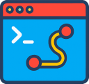

# RouteCheck

[](https://nuget.org/packages/RouteCheck)
[](https://github.com/eisnstein/RouteCheck/blob/main/LICENSE)

Check your API routes in your Terminal.

---

RouteCheck is a dotnet tool for checking/viewing the routes of your ASP.NET Core app in your terminal, like `php artisan route:list` or `mix phx.routes`. The `check` command (default) shows you all routes in a nice table: minimal APIs, controllers, Razor Pages and everything else that is mapped as an endpoint, together with the handler of each route.

RouteCheck works with ASP.NET Core apps on .NET 8 or later. No OpenAPI package or other changes to your app are needed.

## Installation

You can install RouteCheck as a dotnet tool via NuGet:

```sh
# Install
dotnet tool install --global RouteCheck

# Update
dotnet tool update --global RouteCheck
```

## Usage

In your terminal `cd` into a ASP.NET project and run:

```sh
routecheck
```

This should give you something like this:

```
Method Path                     Handler                 Auth
ANY    /                        Page /Index             Anonymous
GET    /api/orders              OrdersController.List   Authenticated
GET    /api/orders/{id:int}     OrdersController.Get    Authenticated
PUT    /api/orders/{id:int}     OrdersController.Update Roles: admin, editor
GET    /health                  Health.Check            Anonymous
ANY    /Orders/Details/{id:int} Page /Orders/Details    Policy: Customer
GET    /pets                    Program (lambda)        Authenticated (fallback)
```

- `ANY` means the route accepts every HTTP method, like Razor Pages do.
- Auth shows who may request the route: `Anonymous` (anyone), or what is required, e.g. `Authenticated`, `Policy: Customer`, `Roles: admin, editor` or `Claim: scope=pets:write`. `(fallback)` means the route has no authorization of its own, so the fallback policy applies. Global MVC filters (`AuthorizeFilter`) are included. The column is left out if anyone may request every route. Note that authorization is only enforced if your app calls `UseAuthorization()`.
- For minimal APIs, the handler is the method passed to `MapGet` etc. A lambda is shown as `(lambda)` with the class it is declared in.
- Controllers with conventional routes (`MapControllerRoute`) are shown with one row per action and their controller and action filled in, e.g. `/Home/About/{id?}`. Shorter URLs from route defaults, like `/` for `HomeController.Index`, are not listed separately.

You can also provide a path to the web app's directory or project file via the `path` option:

```sh
routecheck --path /absolute/path/to/webapp

# or

routecheck -p relative/path/to/webapp/WebApp.csproj
```

RouteCheck waits 20 seconds for your app to start (after building it). If your app needs longer, e.g. because it runs migrations on startup, set the `timeout` option:

```sh
routecheck --timeout 60
```

If your app targets multiple frameworks, choose the one to build and run with the `framework` option:

```sh
routecheck --framework net9.0
```

### Filter routes

The routes are sorted by path, and routes with the same path by method. To show only routes with certain HTTP methods, use the `method` option. It can be used multiple times or with comma-separated values:

```sh
routecheck --method GET -m post

# or

routecheck -m get,post
```

To show only routes whose path contains a text, use the `filter` option. With a wildcard (`*` or `%`), the pattern has to match the whole path. It can be used multiple times, a route has to match one of them:

```sh
# /pets, /pets/{id}, /users/{id}/pets, ...
routecheck --filter pets

# /pets, /pets/{id}, but not /users/{id}/pets
routecheck -f "/pets*"
```

Matching is case-insensitive, like ASP.NET Core routing. `method` and `filter` can be combined. Routes accepting any method (`ANY`) are shown for every `method`.

To review which routes are public, show only the routes anyone may request with `--anonymous`:

```sh
routecheck --anonymous
```

### Problems

Below the routes, RouteCheck lists problems with them. For now, these are ambiguous routes: routes with the same method that match the same requests, e.g. `GET /pets/{id}` and `GET /pets/{name}`. ASP.NET Core can't choose between them, so requesting them fails with an `AmbiguousMatchException`, but only at runtime. Routes whose parameters have different constraints (`/pets/{id:int}`), hosts, accepted content types or orders don't clash.

To fail a CI job on problems, use `--strict`. The exit code is then `2` if there are problems, while errors still exit with `1`:

```sh
routecheck --strict
```

### Compare with a baseline

To see how a change affects your routes, e.g. in a pull request, save the routes as a baseline and compare with it later:

```sh
routecheck --output json > routes.json

# Later: shows the added, removed and changed routes (handler or auth)
routecheck --baseline routes.json
```

Routes are compared by method and path. `method`, `filter` and the other filters apply to the baseline too. With `--strict`, the exit code is `2` if routes of the baseline were removed, as requesting them now fails. You can commit the baseline and update it together with your routes.

### Output for scripts and LLM agents

With `--output json` or `--output markdown`, RouteCheck prints only the result, as one document: no status lines and no update notice.

```sh
routecheck --output json
```

```json
{
  "command": "check",
  "project": "src/Api/Api.csproj",
  "routes": [
    {
      "method": "GET",
      "path": "/pets",
      "handler": "PetsController.List",
      "auth": "Anonymous"
    }
  ],
  "problems": [],
  "error": null
}
```

- `project` is the project file relative to the current directory.
- `handler` is `null` if RouteCheck can't tell what handles the route.
- `problems` lists the [problems](#problems), each with a `type` (e.g. `ambiguous-routes`), a `message` and its `routes`.
- With `--baseline`, `baseline` contains the `added`, `removed` and `changed` routes (each change with `before`, `after` and a `description`). Otherwise it is `null`.
- On an error, `error` contains the message and the exit code is `1`. Otherwise `error` is `null` and the exit code is `0`.
- `--output markdown` prints the same as a Markdown table, e.g. for pull request comments or job summaries.

### How it works

RouteCheck builds your app and starts it with `dotnet run`, adding a [startup hook](https://github.com/dotnet/runtime/blob/main/docs/design/features/host-startup-hook.md) that replaces the web server. Once the app has mapped its endpoints, the hook reads them from ASP.NET Core's routing and stops the app again. So your app never listens on a port, and nothing has to be added to it.

- Hosted services (e.g. a `BackgroundService` consuming a queue) are not started, so they can't do any work while RouteCheck reads the routes.
- The rest of your app's startup code runs as usual, e.g. database migrations before `app.Run()`.
- The app is started with the environment `Development`, unless your launch profile or the `ASPNETCORE_ENVIRONMENT` environment variable sets another one.
- Startup hooks your app already uses (`DOTNET_STARTUP_HOOKS`) are kept.

For help run:

```sh
routecheck -h
```

## LICENSE

MIT
